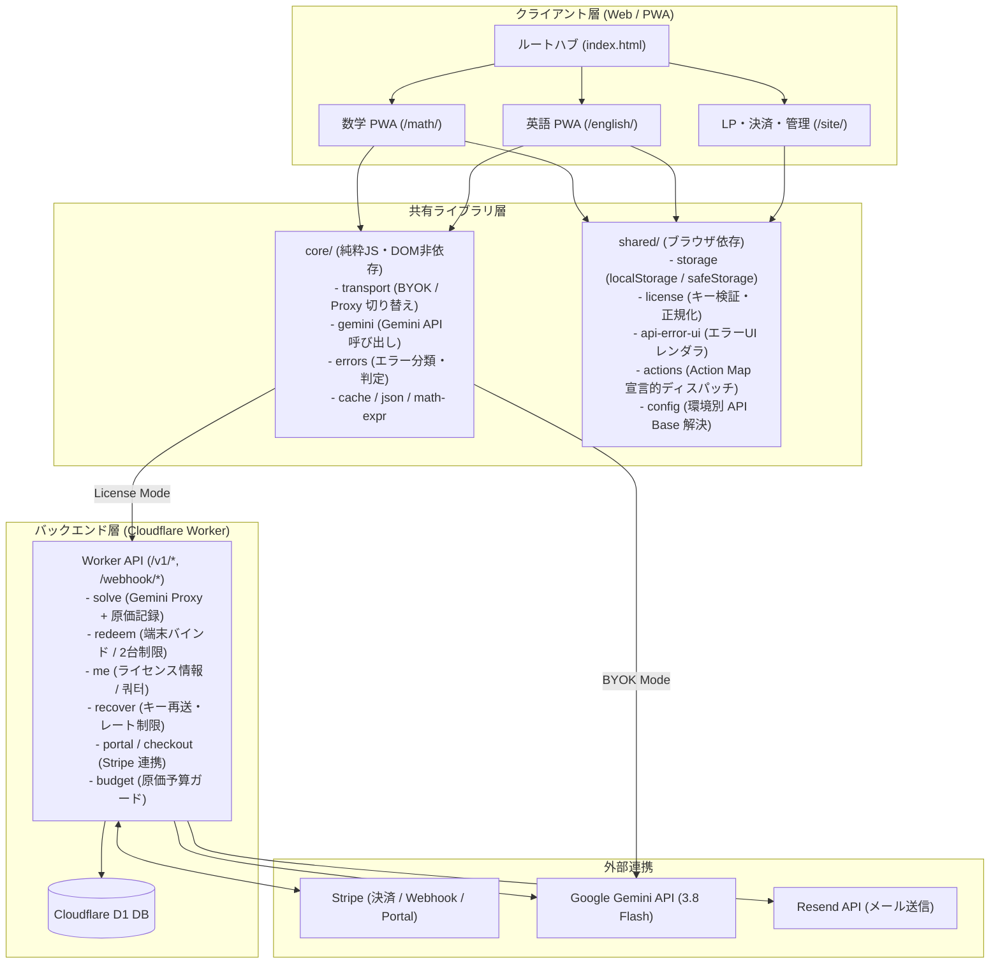
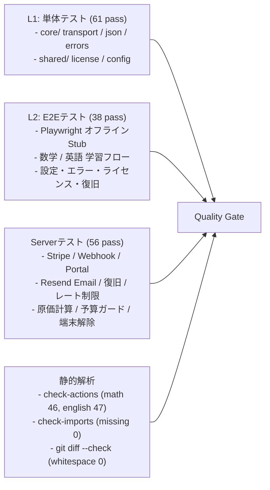

# AIチューター アーキテクチャ設計書 (v2.2)

> **対象リポジトリ**: `ai-math-tutor`
> **現行バージョン**: `v2.2` (Phase 7-6-2A 完了)
> **最終更新**: 2026-11-03
> **目的**: 高校数学・高校英語を同一基盤で提供し、BYOK（APIキー直接入力）および有料サブスクリプション（Stripe + Cloudflare Worker + D1）のハイブリッド運用を実現するシステム構成・ディレクトリ構成・環境分離・品質管理の定義

---

## 1. システム全体構成



---

## 2. ディレクトリ構成

```text
ai-math-tutor/
├── index.html                   # ルートポータルハブ（数学・英語・料金へのナビゲーション）
├── math/                        # 高校数学 PWA
│   ├── index.html               # 数学アプリUI (Tailwind, KaTeX, SVG)
│   ├── main.js / init.js        # エントリポイント・初期化
│   ├── actions-map.js           # 宣言的アクションマップ (46 actions)
│   ├── api-solve.js             # 解法生成・AI呼び出し
│   ├── settings.js              # 設定モーダル (BYOK / License)
│   ├── sw.js / manifest.json    # 数学独立 Service Worker・PWA
│   └── ...                      # UI・描画・クイズモジュール
├── english/                     # 高校英語 PWA
│   ├── index.html               # 英語アプリUI
│   ├── main.js / init.js        # エントリポイント・初期化
│   ├── actions-map.js           # 宣言的アクションマップ (47 actions)
│   ├── reading.js / quiz.js     # 読解・4択クイズ
│   ├── sw.js / manifest.json    # 英語独立 Service Worker・PWA
│   └── ...
├── core/                        # 純粋 JavaScript コア（DOM非依存・Isomorphic）
│   ├── index.js                 # Core 公開エクスポート
│   ├── transport.js             # BYOK と License Proxy の透過的切り替え
│   ├── gemini.js                # callGeminiModel, thinkingLevel
│   ├── errors.js                # classifyApiError (10種類の系統分類)
│   ├── cache.js                 # クライアントメモリ/ストレージキャッシュ
│   ├── json.js                  # 頑健な JSON パーサー
│   ├── http.js                  # fetchWithTimeout
│   └── math-expr.js             # 数式正規化・同値判定
├── shared/                      # ブラウザ共通モジュール
│   ├── config.js                # PROD_API_BASE / STAGING_API_BASE 動的解決
│   ├── license.js               # ライセンスキー・端末ID・バインド管理
│   ├── storage.js               # amt_ / aet_ / tutor_ プレフィックス付き safeStorage
│   ├── actions.js               # data-action 宣言的イベントディスパッチャ
│   ├── api-error-ui.js          # エラー分類結果の HTML レンダラ
│   ├── speech.js                # Web Speech API 音声合成
│   └── ui.js / ui.css           # 共通トースト・ダイアログ・CSS
├── site/                        # マーケティング・決済・サポート静的サイト
│   ├── index.html               # サービス紹介 LP
│   ├── pricing.html             # プラン比較・Stripe Checkout 誘導
│   ├── thanks.html              # 決済完了・セッションキー表示
│   ├── portal.html              # カスタマーポータル（解約・カード変更）
│   ├── recover.html             # ライセンスキー再送フォーム（列挙防止）
│   ├── legal.html               # 特定商取引法・利用規約・プライバシー
│   ├── config.js                # サイト用 API_BASE 解決
│   └── style.css                # サイト共通スタイル
├── server/                      # Cloudflare Worker バックエンド
│   ├── src/
│   │   ├── index.js             # Worker メインルーター (/health, /v1/*)
│   │   ├── solve.js             # Gemini プロキシ・サーバーキャッシュ・原価記録
│   │   ├── license.js           # D1 ライセンス検証・端末バインド・쿼터
│   │   ├── stripe.js            # Webhook 署名検証・キー導出・環境分離
│   │   ├── billing.js           # Checkout Session / Customer Portal 発行
│   │   ├── email.js             # Resend メール送信（キー送付・復旧案内）
│   │   ├── budget.js            # 原価予算ガード (日次/月次上限)
│   │   ├── devices.js           # 端末管理・アンバインド処理
│   │   ├── pricing.js           # トークン原価計算 (gemini-3.8-flash)
│   │   └── cors.js / validate.js# CORS ヘッダー・リクエスト検証
│   ├── migrations/              # D1 SQL マイグレーション (0001〜0005)
│   ├── scripts/                 # 管理者運用スクリプト (new-license, unlink-device)
│   ├── test/                    # サーバー単体テスト (56 pass)
│   ├── wrangler.jsonc           # Production Worker 設定
│   └── wrangler.staging.jsonc   # Staging Worker 設定
├── tests/                       # クライアントテストスイート
│   ├── *.test.js                # L1 単体テスト (61 pass)
│   ├── e2e/*.spec.js            # L2 Playwright E2E テスト (38 pass)
│   ├── check-actions.js         # Action Map 静的解析・整合性検証
│   └── check-imports.js         # ES モジュール依存性検証
├── docs/                        # プロジェクト設計・運用ドキュメント
│   ├── ARCHITECTURE.md          # アーキテクチャ設計書（本書）
│   ├── RESTRUCTURE_PLAN_v2.2.md # 詳細再構築計画・フェーズ進捗
│   ├── LAUNCH_CHECKLIST.md      # リリース前確認チェックリスト
│   ├── OPS.md                   # 運用・DBバックアップ・障害復旧ランブック
│   └── SUPPORT.md               # カスタマーサポート対応マニュアル
├── _headers                     # Staging 検索インデックス拒否 (X-Robots-Tag)
└── .assetsignore                # Staging 配備時の内部ファイル除外設定
```

---

## 3. 環境分離アーキテクチャ (Staging / Production)

本プロジェクトは、テスト環境と本番環境の完全なデータ・トラフィック分離を実現しています。

| 項目 | Staging 環境 | Production 環境 |
|:---|:---|:---|
| **静的サイトホスト** | Cloudflare Workers Assets (`ai-math-tutor-staging`) | GitHub Pages (`https://g4pjo75-gif.github.io/ai-math-tutor/`) |
| **API ホスト** | `https://ai-math-tutor-api-staging.g4pjo75.workers.dev` | `https://ai-math-tutor-api.g4pjo75.workers.dev` |
| **D1 データベース** | `ai-math-tutor-db-staging` | `ai-math-tutor-db` |
| **Stripe** | Test Mode (`sk_test_...`) | Live Mode (`sk_live_...`) |
| **Webhook 隔離** | `APP_ENV = "staging"` (metadata一致検証) | `APP_ENV = "production"` |
| **インデックス制御** | `X-Robots-Tag: noindex, nofollow` | インデックス許可（LP・料金）/ `noindex`（購入・管理） |
| **内部ファイル保護** | `.assetsignore` により `docs/`, `package.json` 等を 404 除外 | GitHub公開範囲に準拠 |

---

## 4. テストと品質管理アーキテクチャ

4層の自動テストにより、品質と回帰防止を担保しています。



---

## 5. セキュリティとプライバシー設計

1. **秘密情報の分離**:
   - `LICENSE_SECRET`, `GEMINI_API_KEY`, `STRIPE_SECRET_KEY`, `RESEND_API_KEY` はすべて Cloudflare Secret として Worker 内部でのみ参照。
   - クライアントコード、ログ、コミット、レポートには一切出力されない。
2. **決定論的ライセンスキー導出**:
   - ライセンスキーは `LICENSE_SECRET` と Stripe Session ID から HMAC-SHA256 で導出 (`deriveLicenseKey`)。
   - DB には平文キーを保存せず、SHA-256 ハッシュ (`key_hash`) のみを保存。
3. **メールアドレス列挙攻撃の防止**:
   - `POST /v1/recover` は、入力されたメールアドレスの登録有無にかかわらず常に同一の `{ ok: true }` を返却。
4. **レートリミットによる乱用防止**:
   - `/v1/solve`: 1分あたり 4〜8 回のバースト制限。
   - `/v1/recover`: IP基準で時間あたり 10 回、同一メール+同一IPで時間あたり 3 回の2段階制限。
5. **予算ガード (Budget Guard)**:
   - Worker 内部で日次/月次の API 原価を自動監視し、上限超過時に即時 503 を返却して課金暴走を遮断。
